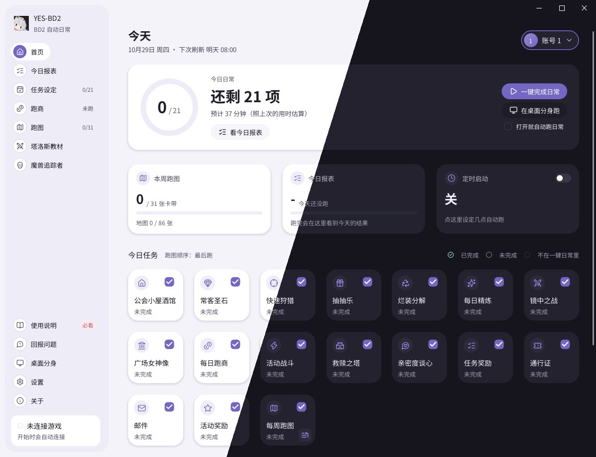
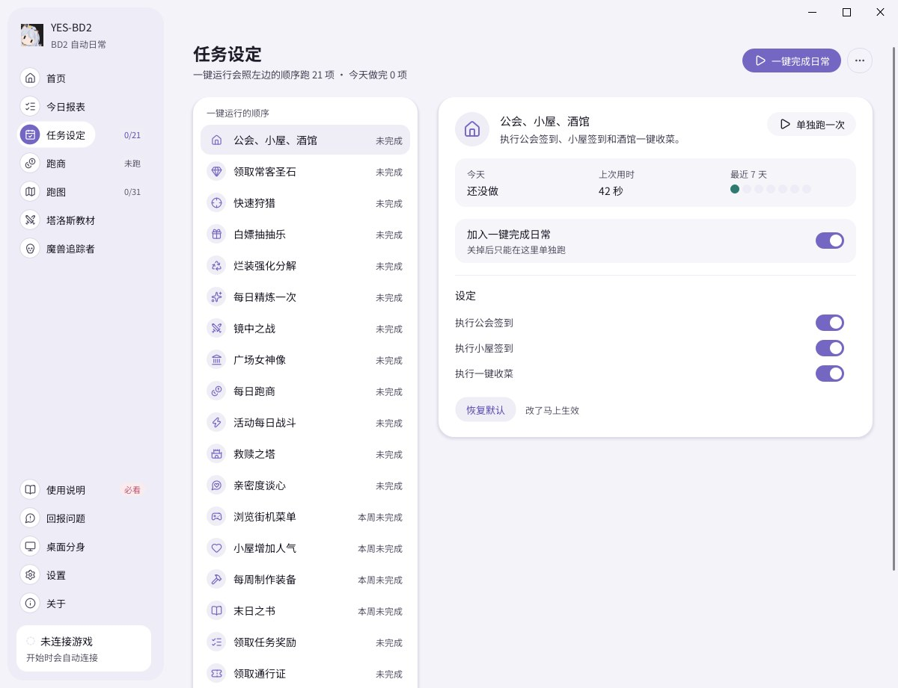
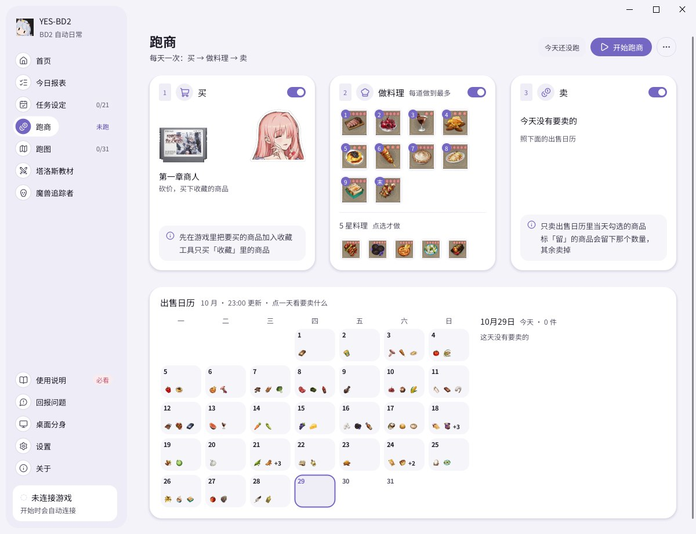
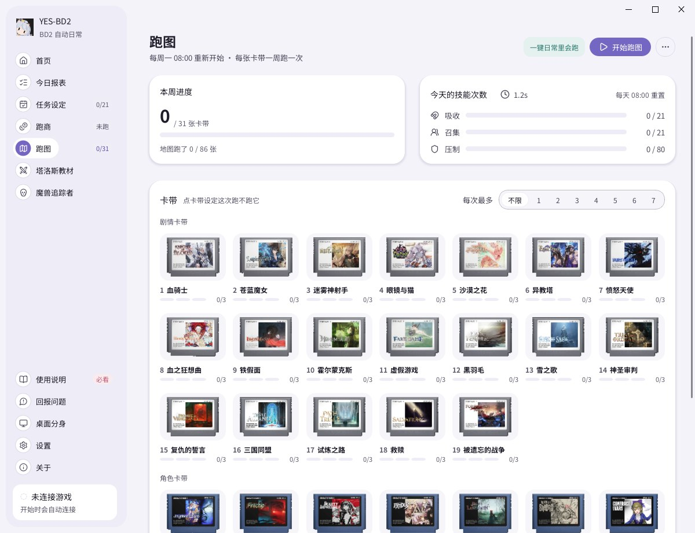
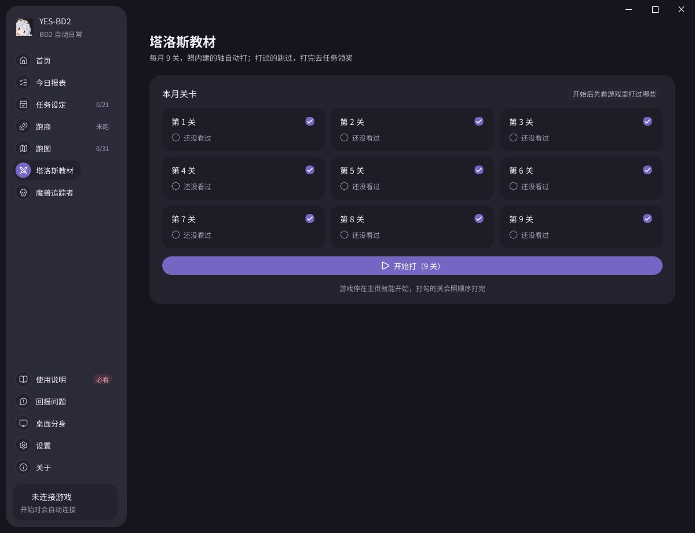
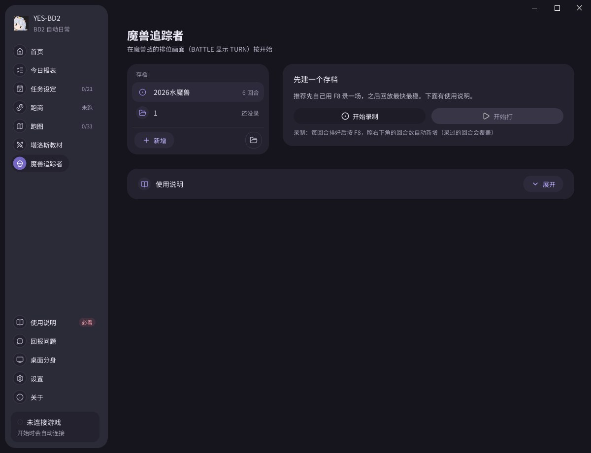
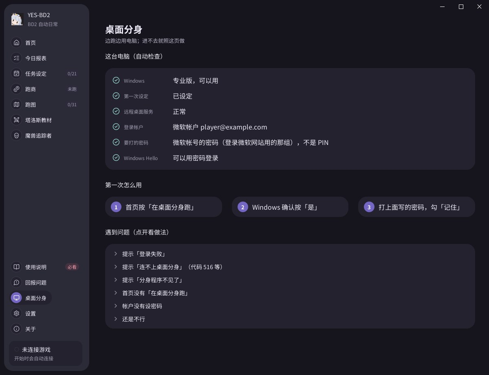

<p align="center">
  
</p>

<h1 align="center">YES-BD2</h1>

<p align="center"><b>打开工具，按一下，棕色尘埃2 的日常就跑完了。</b></p>

<p align="center">
  <b>简体中文</b> · <a href="README.zh-TW.md">繁體中文</a> · <a href="README.en.md">English</a> · <a href="README.ja.md">日本語</a> · <a href="README.ko.md">한국어</a>
</p>

<p align="center">
  <a href="https://github.com/nobell001/YES-BD2/releases/latest"></a>
  
  
  <a href="./LICENSE"></a>
</p>

> [!IMPORTANT]
> **玩家请到 [Releases](https://github.com/nobell001/YES-BD2/releases/latest) 下载 `yes-bd2-win32-online-setup.exe` 安装。** 页面上的 `Source code` 和绿色「Code → Download ZIP」是源码，不是安装包。
>
> **只支持电脑版（桌面应用程序）的棕色尘埃2**，不支持手机和模拟器。
>
> **游戏语言请先切成简体中文。** 工具是看游戏画面上的字来操作的，目前只认得简体中文，**很快会支持更多语言**。
> 工具自己的界面有 5 种语言，在工具的「设置 → 语言」切换。

## 免责声明

- **免费、开源**：个人学习 Python、图像识别、OCR 与界面自动化的作品，不收任何费用。
- **只看画面、模拟鼠标**：不读取、不修改游戏内存和游戏文件。
- **风险自负**：自动化工具可能违反游戏或平台的服务条款，帐号被限制、封禁或奖励被回收，由使用者自行承担。
- **非官方**：和棕色尘埃2 的开发商、发行商及平台没有任何关系。
- **禁止营利**：不接受代练、卖脚本、付费代挂等任何营利用途。

<p align="center"></p>

## 功能

- **一键日常**：公会、小屋、酒馆、常客圣石、快速狩猎、免费抽抽乐、烂装分解、精炼、女神像、镜中之战、活动战斗、救赎之塔、亲密度谈心、任务奖励、通行证、邮件、活动奖励，按一下按顺序跑完。周常（街机菜单、小屋人气、制作装备、末日之书）也在里面。
- **每周跑图**：剧情卡带的吸收、召集、压制自动放，一周的量分到每天跑。
- **每日跑商**：买进、做料理、照出售日历卖出，要留多少自己定。
- **塔洛斯教材**：每月 9 关照内建的打法自动打，打过的跳过。
- **魔兽追踪者**：先用 F8 录一场自己的打法，之后每回合的顺序、站位和技能都照录好的自动排好再开打。
- **定时启动**：设定几点，时间到了自动跑日常，工具没开也会自己打开。
- **桌面分身**：游戏在另一个独立的桌面窗口里跑，你照常用电脑，鼠标键盘不会被抢。
- **游戏里显示进度**：跑的时候游戏上方显示正在跑什么，有暂停、停止按钮，不挡点击。
- **今日报表**：今天跑了什么、哪一项失败、为什么失败，一眼看完。

## 特点

- **认不准就不按**：画面没认清楚就不点，卡住会回主页或停下来，不会乱点。
- **不花钱**：付费体力、钻石、付费道具一律不碰，免费次数用完就停。
- **不用盯着**：跑完会在 Windows 右下角通知你。
- **会自己更新**：每次打开工具都会检查新版本，不用重新下载。
- **1080p、2K、4K 都能用**：只要是 16:9。

## 三步开始

1. 到 [Releases](https://github.com/nobell001/YES-BD2/releases/latest) 下载 **`yes-bd2-win32-online-setup.exe`**（约 5 MB），安装。安装时会联网下载其余部分，请保持网络连接。如果 Windows 跳出「已保护你的电脑」，点「更多信息 → 仍要运行」（安装包没有付费签名，新发布的文件都会这样）。
2. 把游戏语言切成**简体中文**，画质选 FHD。
3. 打开工具，按「**一键完成日常**」。游戏没开的话，工具会先问你要不要帮你开。

> 想边跑边用电脑？按「**在桌面分身跑**」（需要 Windows 专业版，第一次要设定一下）。

## 更多画面

<table>
  <tr>
    <td></td>
    <td></td>
    <td></td>
  </tr>
  <tr>
    <td align="center">任务设定：要跑哪些自己勾</td>
    <td align="center">跑商：买、做、卖</td>
    <td align="center">跑图：一周进度一目了然</td>
  </tr>
  <tr>
    <td></td>
    <td></td>
    <td></td>
  </tr>
  <tr>
    <td align="center">塔洛斯教材：每月 9 关一键打</td>
    <td align="center">魔兽追踪者：照自己录的打法排</td>
    <td align="center">桌面分身：边跑边用电脑</td>
  </tr>
</table>

## 跑之前注意

- 不要锁屏、关屏幕或让电脑睡眠，游戏窗口不要最小化。
- 关掉显卡滤镜、锐化、FPS 显示、录屏悬浮窗这类盖在画面上的东西。
- 一般模式会用你的鼠标，跑的时候别动电脑；要同时用电脑就用桌面分身。
- 工具每次打开会要管理员权限（Windows 会问一次），点「是」就好。

## 遇到问题

| 状况 | 怎么办 |
|---|---|
| 找不到游戏 | 先把游戏打开；装在特别的位置的话，见下面「从源码运行」的路径设定 |
| 认不出画面 | 检查游戏语言是不是简体中文、是不是 16:9、有没有东西挡住游戏 |
| 某一项一直失败 | 打开「今日报表」看失败原因和截图，到 [Issues](https://github.com/nobell001/YES-BD2/issues) 告诉我们 |

回报时附上今日报表的截图最有帮助。截图可能看得到游戏帐号资讯，贴之前先看一下。

<details>
<summary><b>桌面分身怎么设定</b></summary>

桌面分身让游戏在另一个独立的桌面窗口里跑，你照常用电脑，鼠标键盘不会被抢。

**需要**

- Windows 10/11 专业版、企业版或教育版。家庭版不能用。
- Windows 的「远程桌面服务」还在、没被停用。分身是这台电脑用远程桌面连自己，用过系统优化／精简工具或精简版 Windows 的电脑常会动到它；工具会先检查，被停用时可以按「帮我打开」（不会让别的电脑连进来）。
- 知道 Windows 帐户的密码（Microsoft 帐户就是微软帐户密码）。PIN 不行。

**第一次**

1. 首页按「在桌面分身跑」→「第一次设定」，Windows 确认按「是」。
2. 用 Microsoft 帐户、而且只允许 Windows Hello 登录的电脑，工具会请你按「帮我关掉」。
3. 再按一次「在桌面分身跑」→「前往」，Windows 确认按「是」。
4. 登录框打 Windows 帐户密码（不是 PIN），勾「记住我的凭据」，之后就不用再打。
5. 分身窗口打开后，游戏和日常会自己开始，进度在工具里看。分身窗口缩小也照跑；按 X 会结束分身，里面的游戏和工具一起关。

不想用了：「设置」→「还原桌面分身」→「还原」。

**常见问题**

| 状况 | 怎么办 |
|---|---|
| 登录失败、密码不对 | 打帐户密码不是 PIN；Microsoft 帐户要打微软帐户密码；只允许 Windows Hello 的话先按「帮我关掉」 |
| 出现「516」或「未启用对服务器的远程访问／远程计算机已关闭」 | 这是连不上分身，不是密码问题。依序试：重开工具再按一次 → 重新开机再试（刚设定完常要重开机）→ 用过系统优化／精简工具或装过 RDP Wrapper 的电脑可能不能用。还不行请到 [Issues](https://github.com/nobell001/YES-BD2/issues) 附上 `%LOCALAPPDATA%\bd2-auto\clone-desktop\viewer.log` |
| 分身程序不见了 | 防毒软件（例如 360、火绒）可能删掉了：把 `%LOCALAPPDATA%\bd2-auto\clone-desktop` 设为信任，再按「第一次设定」 |
| 电脑关不了机 | 先按 X 关掉分身窗口；或在任务管理器 →「用户」里注销进程较少的同名用户 |

</details>

## 下载哪个文件

| 文件 | 说明 |
|---|---|
| `yes-bd2-win32-online-setup.exe` | **选这个**。约 5 MB，安装时再联网下载其余部分，通常比较快 |
| `yes-bd2-win32-Full-setup.exe` | 完整离线安装包，文件很大；安装时不能联网才用 |

GitHub 自动附的 `Source code` 压缩包和 `yes-bd2-win32.zip` 不是安装包，一般玩家不用下载。

<details>
<summary><b>从源码运行（开发者）</b></summary>

源码方式**不会自动更新**，需要自己 `git pull`。

```powershell
git clone https://github.com/nobell001/YES-BD2.git
cd YES-BD2
py -3.12 -m venv .venv
.\.venv\Scripts\pip install -r requirements.txt
.\start.bat
```

游戏不在默认位置时，启动前先设定：

```powershell
$env:OK_BD2_LAUNCHER_PATH = "C:\Path\To\Browndust2Starter.exe"
$env:OK_BD2_GAME_PATH = "D:\Path\To\BrownDust II.exe"
```

依赖以 `pyproject.toml` 和 `uv.lock` 为准，`requirements*.txt` 由 uv 导出，不要手改。

```powershell
.\scripts\run_checks.ps1 -Mode Focused -Tests tests.test_pvp_task   # 只跑受影响的测试
.\scripts\run_checks.ps1 -Mode Final                                # 提交前完整检查
```

更多：[架构说明](docs/architecture.md) · [发布检查清单](docs/release-checklist.md) · [PyAppify 发布流程](docs/pyappify-release-flow.md)

</details>

## 致谢

YES-BD2 基于 [GodRaymond233/ok-bd2](https://github.com/GodRaymond233/ok-bd2) 制作，框架和一键更新来自 [ok-script](https://github.com/ok-oldking/ok-script)。也谢谢：

- [BD2DB 图鉴](https://browndust2-db.souseha.com/)：游戏名称与资料
- B站 [時樂淵](https://space.bilibili.com/14949646)：跑商售卖物品表
- [BetterGI](https://github.com/babalae/better-genshin-impact)、[ChildStream](https://github.com/mattxslv/childstream)：桌面分身的做法与画面窗口
- [JZPPP/MaaBD2](https://github.com/JZPPP/MaaBD2)：地图采集路线参考

工具「关于」页有完整致谢；第三方依赖与素材见 [THIRD_PARTY_NOTICES.md](THIRD_PARTY_NOTICES.md)。

## 授权

程序代码以 [GPL-3.0](LICENSE) 发布（与 ok-bd2 相同）。游戏名称、截图、图标与界面素材的权利属于各自的权利方。
